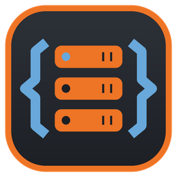
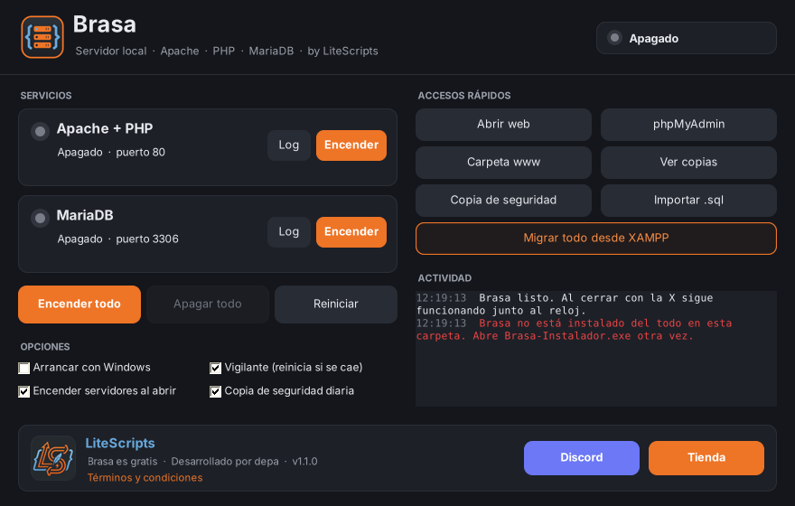

<p align="center">
  
</p>

<h1 align="center">Brasa</h1>

<p align="center">
  Local server for Windows: <b>Apache + PHP 8.4 + MariaDB + phpMyAdmin</b><br>
  with a control panel, tray icon, watchdog and automatic backups.<br>
  Free · by <a href="https://lite-scripts.com/">LiteScripts</a> · developed by hotbambi
</p>

<p align="center">
  <a href="../../releases/latest"><b>⬇ Download Brasa</b></a> ·
  <a href="https://discord.gg/ffSndEucDF">Discord</a> ·
  <a href="https://lite-scripts.com/">Store</a>
</p>

<p align="center"><a href="README.md">Español</a> · <b>English</b></p>

<p align="center"></p>

## What it does

- **One-click installer.** Downloads Apache, PHP, MariaDB and phpMyAdmin from their official websites and configures everything.
- **Panel and tray icon.** Start, stop and check the status of each service. Closing the window with the X keeps it running next to the clock, with an icon whose color changes with the status.
- **Watchdog.** If Apache or MariaDB crash, it starts them again.
- **Clean MariaDB shutdown**, also when Windows shuts down, so your tables don't get corrupted.
- **Backups**, automatic daily and manual (keeps the last 15).
- **Import .sql** files with no size limit.
- **Migrate from XAMPP:** moves your databases and your `htdocs` projects to Brasa.
- **Ports in use:** tells you which program is using the port.
- **Languages:** Spanish, English, French and German. It follows the Windows language and can be changed from the installer or the panel.
- Start with Windows, Start menu shortcut and uninstaller in *Installed apps*.

## Installation

1. Download `Brasa-Instalador.exe` from [Releases](../../releases/latest).
2. If Windows shows "Windows protected your PC", click **More info → Run anyway** (the program is not signed).
3. Accept the terms, keep the folder as `C:\Brasa` and click **Install**.

| | |
|---|---|
| Your projects | `C:\Brasa\www` |
| Website | http://localhost/ |
| phpMyAdmin | http://localhost/phpmyadmin |
| Database | `localhost` · user `root` · no password · port 3306 |

Requirements: 64-bit Windows 10 or 11 (includes .NET Framework 4.8) and an internet connection for the installation.

## Building from source

It is compiled with Mono against the .NET Framework 4.7.2 libraries, so it runs on any Windows 10/11 without installing anything:

```bash
sudo apt install mono-devel        # or mono-complete
./build.sh                          # produces build/Brasa.exe and build/Brasa-Instalador.exe
```

To regenerate the icons: `python3 tools/iconos.py res` (requires Pillow).

### Translations

The interface texts are written in Spanish in the code and wrapped in `L.T("...")` (or `L.F("... {0}", x)` when they contain values). Their English, French and German versions are in `src/Textos.cs`; if a translation is missing, the Spanish text is shown. The terms and conditions are in `src/Terminos.cs`, the installation script messages in `payload/scripts/config.ps1` and the start page texts in `payload/www/index.php`. The chosen language is saved as `Idioma=` in `brasa.ini`.

## Structure

```
src/        C# code (panel, installer, migration, services, translations)
payload/    Script that downloads and configures the components + start page
res/        Icons and logos
tools/      Icon generator
```

## Support

Drop by the [LiteScripts Discord](https://discord.gg/ffSndEucDF). It's a free program, so replies aren't guaranteed.

## Terms

Use of Brasa is subject to the [terms and conditions](TERMINOS.md) (in Spanish; the app shows them in your language). Brasa is provided "as is", without warranty.

Apache HTTP Server, PHP, MariaDB, phpMyAdmin and XAMPP belong to their respective authors and are governed by their own licenses. Brasa is not affiliated with or endorsed by any of them; they are only named to indicate compatibility.
