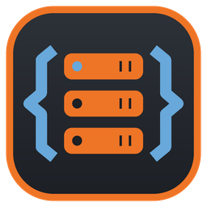
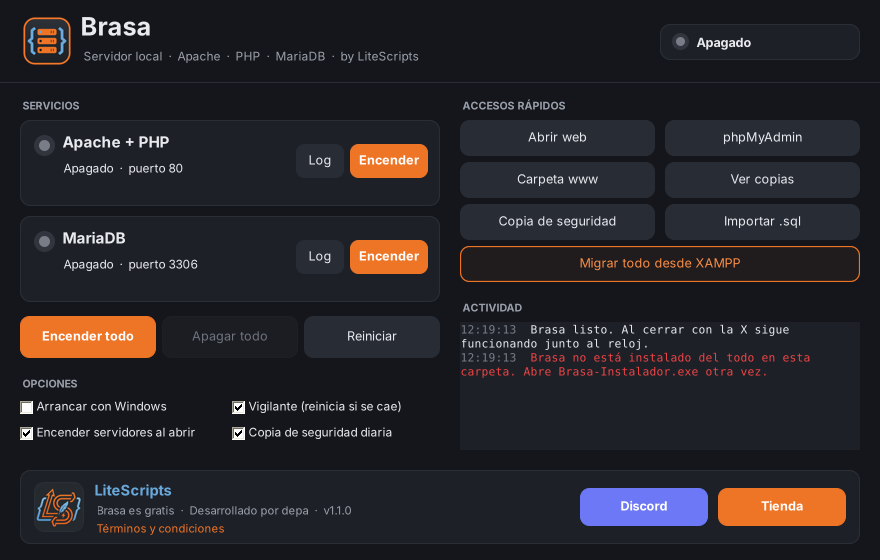

<p align="center">
  
</p>

<h1 align="center">Brasa</h1>

<p align="center">
  Servidor local para Windows: <b>Apache + PHP 8.4 + MariaDB + phpMyAdmin</b><br>
  con panel, icono junto al reloj, vigilante y copias de seguridad automáticas.<br>
  Gratis · por <a href="https://lite-scripts.com/">LiteScripts</a> · desarrollado por hotbambi
</p>

<p align="center">
  <a href="../../releases/latest"><b>⬇ Descargar Brasa</b></a> ·
  <a href="https://discord.gg/ffSndEucDF">Discord</a> ·
  <a href="https://lite-scripts.com/">Tienda</a>
</p>

<p align="center"><b>Español</b> · <a href="README.en.md">English</a></p>

<p align="center"></p>

## Qué hace

- **Instalador en un clic.** Descarga Apache, PHP, MariaDB y phpMyAdmin de sus webs oficiales y lo configura todo.
- **Panel y bandeja.** Enciende, apaga y mira el estado de cada servicio. Al cerrar con la X sigue funcionando junto al reloj, con un icono que cambia de color según el estado.
- **Vigilante.** Si Apache o MariaDB se caen, los vuelve a encender.
- **Apagado limpio de MariaDB**, también al apagar Windows, para que no se corrompan las tablas.
- **Copias de seguridad** diarias automáticas y manuales (guarda las 15 últimas).
- **Importar .sql** sin límite de tamaño.
- **Migrar desde XAMPP:** pasa tus bases de datos y proyectos de `htdocs` a Brasa.
- **Puertos ocupados:** te dice qué programa está usando el puerto.
- **Idiomas:** español, inglés, francés y alemán. Sigue el idioma de Windows y se puede cambiar desde el instalador o el panel.
- Arranque con Windows, acceso en el menú Inicio y desinstalador en *Aplicaciones instaladas*.

## Instalación

1. Descarga `Brasa-Instalador.exe` desde [Releases](../../releases/latest).
2. Si Windows muestra «Windows protegió su PC», pulsa **Más información → Ejecutar de todas formas** (el programa no está firmado).
3. Acepta los términos, deja la carpeta en `C:\Brasa` y pulsa **Instalar**.

| | |
|---|---|
| Tus proyectos | `C:\Brasa\www` |
| Web | http://localhost/ |
| phpMyAdmin | http://localhost/phpmyadmin |
| Base de datos | `localhost` · usuario `root` · sin contraseña · puerto 3306 |

Requisitos: Windows 10 u 11 de 64 bits (incluye .NET Framework 4.8) y conexión a internet para la instalación.

## Compilar desde el código

Se compila con Mono contra las bibliotecas de .NET Framework 4.7.2, así que funciona en cualquier Windows 10/11 sin instalar nada:

```bash
sudo apt install mono-devel        # o mono-complete
./build.sh                          # genera build/Brasa.exe y build/Brasa-Instalador.exe
```

Para regenerar los iconos: `python3 tools/iconos.py res` (necesita Pillow).

### Traducciones

Los textos de la interfaz están escritos en español en el código y envueltos en `L.T("...")` (o `L.F("... {0}", x)` si llevan datos). Sus versiones en inglés, francés y alemán están en `src/Textos.cs`; si falta alguna, se muestra el texto en español. Los términos están en `src/Terminos.cs`, los mensajes del script de instalación en `payload/scripts/config.ps1` y los de la página de inicio en `payload/www/index.php`. El idioma elegido se guarda como `Idioma=` en `brasa.ini`.

## Estructura

```
src/        Código C# (panel, instalador, migración, servicios, traducciones)
payload/    Script que descarga y configura los componentes + página de inicio
res/        Iconos y logos
tools/      Generador de iconos
```

## Soporte

Pásate por el [Discord de LiteScripts](https://discord.gg/ffSndEucDF). Es un programa gratuito, así que no se garantiza respuesta.

## Términos

El uso de Brasa está sujeto a los [términos y condiciones](TERMINOS.md). Brasa se ofrece «tal cual», sin garantía.

Apache HTTP Server, PHP, MariaDB, phpMyAdmin y XAMPP pertenecen a sus respectivos autores y se rigen por sus propias licencias. Brasa no está afiliado ni respaldado por ninguno de ellos; solo se nombran para indicar compatibilidad.
